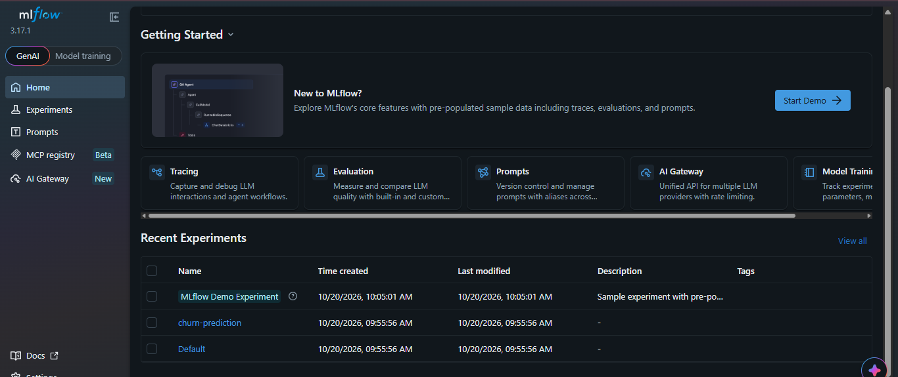
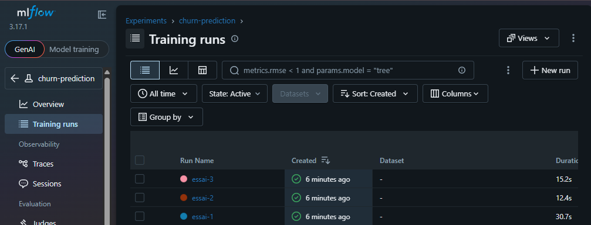
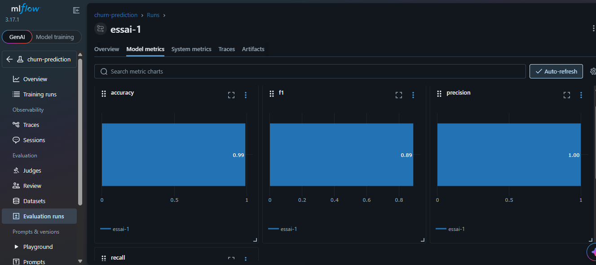
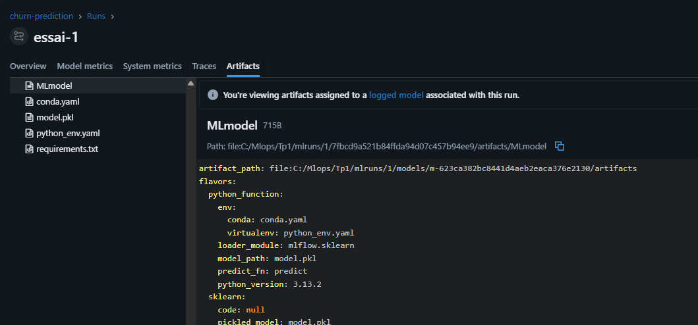

## 📊 Résultats MLflow

### 1. Expérience Churn Prediction

Cette capture montre l'expérience créée dans MLflow.

### 2. Comparaison des essais

Les trois essais permettent de comparer les performances des modèles.

### 3. Détails d'un essai

Les paramètres et les métriques du modèle sont enregistrés dans MLflow.

### 4. Modèle enregistré

Le modèle entraîné est sauvegardé dans les artifacts MLflow.

